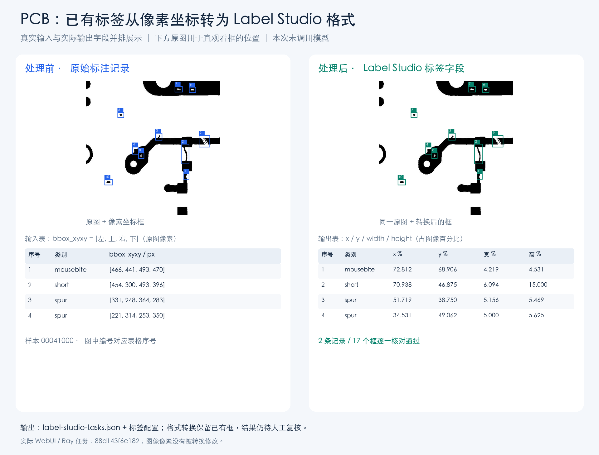
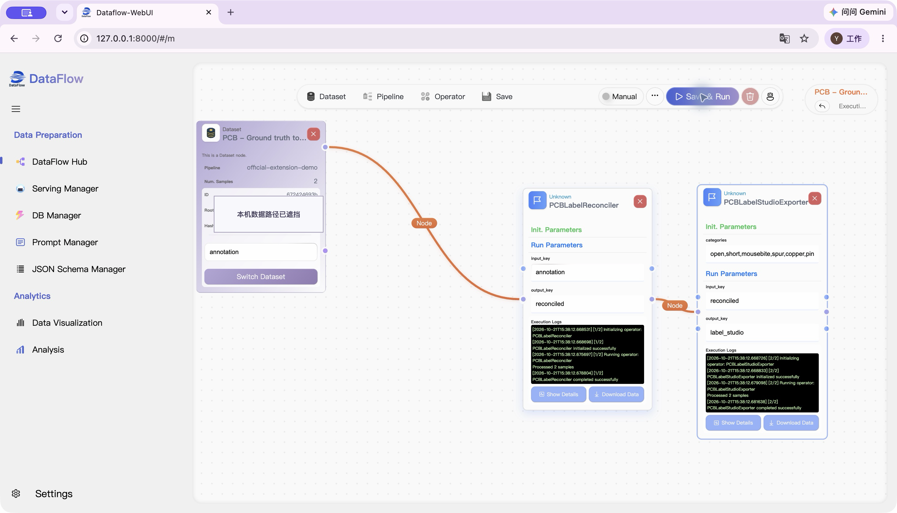

# dataflow-pcb-inspection

面向 PCB 缺陷数据整理与标注的 [DataFlow](https://github.com/OpenDCAI/DataFlow) 扩展。把 PCB 图片、已有缺陷框和复核结果串成可重复运行的数据处理流程，输出 Label Studio 标注文件或带来源记录的合成样本。

## 适用场景

- **已有图片和缺陷坐标，需要转换标注格式**：核对已有标签，把原图像素坐标转换成 Label Studio 使用的百分比坐标，供后续查看和复核。
- **需要模型辅助标注**：把待检图、参考图和检查规则交给多图模型，得到缺陷类别和位置，再交由人工确认。
- **需要补充缺陷样本**：利用已有缺陷图片和掩码进行几何变换与模板合成，输出图片、掩码、缺陷框和来源记录。

| 功能 | 输入 | 输出 | 是否需要模型 |
|---|---|---|---|
| 已有标注转换 | PCB 图片、缺陷类别、像素坐标框 | Label Studio 任务 JSON、标签配置 XML | 否 |
| 模型预标注 | 待检图、参考图、检查规则 | 缺陷建议、位置和待复核记录 | 是，需配置多图 Serving |
| 人工复核结果合并 | 原始标注记录、人工决策或 Label Studio 导出文件 | 保留原标签及修改来源的复核结果 | 否 |
| 模板合成 | 已标注缺陷、目标图片、掩码和变换参数 | 合成图片、掩码、坐标框及来源信息 | 否 |

已有标注转换由 Python 代码完成坐标换算和文件整理；它保留已有缺陷信息，不执行缺陷识别。模型预标注与模板合成的结果需要人工复核后再用于业务数据。

## 安装

需要 Python 3.10–3.12，依赖 `open-dataflow==1.0.11`。

```bash
git clone https://github.com/Pyromind-Dynamics/dataflow-pcb-inspection.git
cd dataflow-pcb-inspection
python -m venv .venv
source .venv/bin/activate
python -m pip install --upgrade pip
python -m pip install .
```

## 快速开始：转换已有标注

包内提供了一组示例图片和一个已有缺陷框，无需模型或 API key 即可运行：

```bash
python -m dataflow_pcb_inspection.pipelines.labels_demo --output artifacts/labels-demo
```

示例通过 DataFlow Pipeline 完成：

```text
图片和已有像素框 → 标签核对 → Label Studio 格式转换 → 保存文件
```

结果保存在 `artifacts/labels-demo/`：

| 文件 | 内容 |
|---|---|
| `input.jsonl` | 本次处理的图片引用和已有标注 |
| `label_studio_tasks.json` | 可导入 Label Studio 的任务文件，包含转换后的坐标 |
| `label_config.xml` | 对应的 Label Studio 标签配置 |
| `steps/labels_step1.jsonl`、`steps/labels_step2.jsonl` | 标签核对结果和转换结果 |
| `summary.json` | 处理数量、框数量和是否调用模型 |

本例处理 1 条记录、1 个框，汇总结果中 `relation` 为 `keep`、`model_called` 为 `false`。再次运行请使用新的输出目录。

使用自己的数据时，按 [输入格式与接口说明](docs/CONTRACT.md) 准备包含图片、已有标注和版本绑定信息的记录，再复用 `pipelines.labels_demo.LabelConversionPipeline`。在 Label Studio 中查看图片，还需要把任务中的图片路径映射为该服务可访问的媒体地址。

## 实际案例：PCB 标注格式转换

下面使用 DeepPCB 图片及其已有标注演示转换过程，共处理 **2 条记录、17 个缺陷框**。

- **处理前**：PCB 原图，以及用像素坐标描述的缺陷类别和位置。
- **处理过程**：核对标签，将像素坐标转换成 Label Studio 的百分比字段。
- **处理后**：Label Studio 任务 JSON 和标签配置。输出坐标还原为像素后与输入框一致。

这条流程不调用模型。图中的原图、缺陷框和 JSON 字段共同展示同一批数据在转换前后的对应关系。



### 在 DataFlow-WebUI 中运行该案例

同一处理流程也可以在官方 [DataFlow-WebUI](https://github.com/OpenDCAI/DataFlow-WebUI) 中配置和执行。下图是该案例的运行界面，使用标签核对和 Label Studio 导出节点：



接入方式：

1. 在 WebUI 后端及其 Ray worker 使用的 Python 环境中安装本扩展。
2. 在后端 `backend/app/core/config.py` 的 `_DATAFLOW_EXTENSIONS` 列表中加入 `"dataflow_pcb_inspection"`，保留已有条目并重启后端。
3. 选择输入数据，连接 `PCBLabelReconciler` 和 `PCBLabelStudioExporter`，配置字段并点击 **Save & Run**。

输入图片须能被执行后端访问。处理记录由 DataFlow Storage 保存到配置的输出位置；上述快速开始脚本还会把任务 JSON 和 XML 整理为独立文件，便于导入 Label Studio。

## 其他用法

### 模型预标注与复核

预标注输入是 JSONL，每行包含一个 `sample`，例如：

```json
{"sample":{"id":"pcb-001","inspection_rules":"检查待检图中的缺陷，输出类别和原图像素坐标。","images":[{"id":"target","role":"inspection","path":"board.png"},{"id":"reference","role":"reference","path":"reference.png"}]}}
```

图片路径相对 `image_root`。调用 `PCBMultiImageAnnotationGenerator` 时传入支持 `generate_from_input_multi_images` 的 DataFlow Serving；输出包含缺陷类别、对应图片和 `bbox_xyxy` 坐标框。结果保持待复核状态，可通过复核算子或 Label Studio 文件导入导出完成后续处理。具体参数和记录格式见 [接口说明](docs/CONTRACT.md)。

### 体验预标注、复核与合成的数据流

```bash
python -m dataflow_pcb_inspection.pipelines.demo --output artifacts/full-demo
```

这个独立示例使用固定的模型响应和模拟复核决策，演示完整文件流转，不调用真实模型。输出包括分步 JSONL、Label Studio 文件、`simulated_review.json`、`synthesis/` 和 `summary.json`，均位于指定的新输出目录。

## 算子与 DataFlow 接口

安装后执行 `import dataflow_pcb_inspection` 即可注册算子和 Prompt。

| 算子 | 作用 |
|---|---|
| `PCBMultiImageAnnotationGenerator` | 多图模型预标注 |
| `PCBLabelReconciler` | 核对原标签与候选标签，记录一致或冲突 |
| `PCBReviewExporter` / `PCBReviewDecisionMerger` | 导出复核记录、合并人工决策 |
| `PCBLabelStudioExporter` / `PCBLabelStudioImporter` | 转换本地 Label Studio 文件 |
| `PCBTemplateSynthesisGenerator` | 基于已有标注进行模板合成 |

算子通过 `run(storage, input_key=..., output_key=...)` 接入 DataFlow，保留输入行和源列，并新增结果列；`output_key` 必须是尚不存在的列。使用 `get_desc("zh")` 或 `get_desc("en")` 可查看各算子的参数和字段说明。

当前支持本地 JPEG/PNG 和未旋转矩形框；Label Studio 集成采用文件导入导出方式。完整数据约束、错误处理及合成参数见 [CONTRACT.md](docs/CONTRACT.md)。

## 开发与文档

```bash
python -m pip install -e '.[dev]'
python -m pytest -q
```

- [输入格式、算子参数与处理约束](docs/CONTRACT.md)
- [验证记录](docs/VALIDATION.md)
- [更新记录](CHANGELOG.md)

代码采用 [MIT 许可证](LICENSE)。上述案例图片来自 DeepPCB，数据集使用范围及其他第三方来源见 [THIRD_PARTY_NOTICES.md](THIRD_PARTY_NOTICES.md)。
